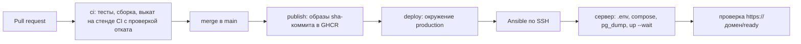

# Развёртывание на сервере

ППшкин работает на одном сервере: Caddy принимает HTTPS на 443 и сам выпускает сертификат Let's Encrypt, backend и мини-приложение запускаются из готовых образов GHCR, PostgreSQL хранит данные на томе Docker. Состав сервисов описан в [compose.prod.yaml](../compose.prod.yaml) и [deploy/Caddyfile](../deploy/Caddyfile), настройку сервера и выкат выполняет Ansible из [deploy/ansible](../deploy/ansible), запускает выкат GitHub Actions.

Рабочий домен сервиса `hackathon.easymythic.dev`, ниже `<домен>` означает его. Наружу опубликован только Caddy (порты 80, 443/tcp и 443/udp). Backend и база доступны только внутри сети проекта Docker.

Маршрутизация Caddy:

| Путь | Куда |
|---|---|
| `/grafana`, `/grafana/*` | `grafana:3000` (дашборд мониторинга, раздел 11) |
| `/api/*`, `/docs`, `/docs/*`, `/health`, `/ready`, `/max/webhook` | `backend:3000` |
| всё остальное | `frontend:8080` (статические файлы мини-приложения) |

Журнал запросов Caddy выключен намеренно: в query-параметрах есть координаты пользователей. Backend по той же причине пишет в журнал только метод и путь запроса, без параметров и IP-адреса клиента. Журналы всех контейнеров ротируются: не больше пяти файлов по 10 МБ на сервис (`x-logging` в `compose.prod.yaml`). Из остальных записей Caddy (например, об ошибке 502, пока backend перезапускается) удаляется заголовок `X-Max-Bot-Api-Secret` с секретом webhook. Заголовок `X-Frame-Options` не ставится, потому что веб-версия MAX открывает мини-приложение в iframe с другого домена. Лимит тела запроса 11 МБ чуть больше лимита загрузки фото (10 МБ).

## Непрерывная поставка

Состояние продакшена целиком описано в репозитории: состав сервисов, конфигурация Caddy, настройка сервера и версии образов. Любое изменение попадает на сервер только через pull request в `main`, вручную на сервере ничего не правится.



Как устроен выкат:

- Каждый push в `main` собирает образы `ghcr.io/blsssss/ppshkin-backend` и `ghcr.io/blsssss/ppshkin-frontend` с неизменяемым тегом `sha-<7 символов коммита>` ([publish.yml](../.github/workflows/publish.yml)) и сразу вызывает [deploy.yml](../.github/workflows/deploy.yml) для этого коммита.
- Job `deploy` работает в окружении GitHub `production`: выкатывать в него можно только из ветки `main`, секреты окружения доступны только этому job. Выкаты идут по одному (`concurrency`), история видна на вкладке Deployments репозитория.
- Ansible берёт `compose.prod.yaml`, `deploy/Caddyfile` и роли из того же коммита, что и образы, поэтому код и конфигурация на сервере всегда из одной версии.
- Плейбук идемпотентный: каждый выкат заново применяет всё состояние, включая файл `.env`, и перезаписывает ручные изменения на сервере.
- Перед выкатом делается копия базы, после `up --wait` Docker ждёт, пока все сервисы станут здоровыми. Если новая версия не поднялась, Ansible возвращает предыдущий тег и завершает job ошибкой.
- Job `deploy` в [ci.yml](../.github/workflows/ci.yml) на каждом pull request выполняет тот же плейбук на раннере CI: выкатывает рабочую версию, проверяет HTTPS, заголовки Content Security Policy у `/`, `/index.html`, API и `/docs`, приём отчётов `POST /api/v1/csp-reports`, демо-данные, права на `.env` и копию базы, затем выкатывает версию с падающим backend и проверяет, что вернулась рабочая.
- Jobs `backend` и `frontend` запускают `npm audit --omit=dev --audit-level=high`: pull request с зависимостью, у которой есть известная уязвимость уровня high или critical, не проходит. Job `security` и job `docker` сканируют Trivy файлы репозитория и собранные образы на уязвимости и секреты и падают на HIGH и CRITICAL, для которых есть исправление. Action Trivy закреплён по SHA коммита.

Исключение из проверки Trivy допускается, только когда исправления ещё нет или уязвимый код не используется. Оно добавляется в [.trivyignore.yaml](../.trivyignore.yaml) с причиной в поле `statement` и датой пересмотра в поле `expired_at`, после которой проверка снова падает:

```yaml
vulnerabilities:
  - id: CVE-2026-00000
    paths:
      - backend/package-lock.json
    statement: уязвимая функция не вызывается, исправленной версии пока нет
    expired_at: 2026-12-01
secrets: []
```

Сейчас исключений нет. Уязвимость в `npm audit` исключением не закрывается: зависимость обновляется до исправленной версии, при необходимости через `overrides` в `package.json`.

Роли Ansible:

| Роль | Плейбук | Что делает |
|---|---|---|
| `docker` | `bootstrap.yml`, от root, один раз | Docker Engine и плагин Compose из официального репозитория Docker |
| `base` | `bootstrap.yml`, от root, один раз | пользователь `deploy` с ключом CI, вход по SSH только по ключам, `ufw`, автоматические обновления безопасности, каталог `/opt/ppshkin` |
| `app` | `site.yml`, от `deploy`, каждый выкат | `.env` из секретов GitHub, `compose.prod.yaml` и `Caddyfile` коммита, копия базы, `pull` и `up --wait`, откат, перезапуск Caddy при изменении `Caddyfile` |
| `backup` | `site.yml`, от `deploy`, каждый выкат | скрипты `/opt/ppshkin/backup.sh` (ежедневная копия, шифрование и выгрузка во внешнее хранилище) и `/opt/ppshkin/restore-check.sh` (еженедельная проверка восстановления), их запуск по cron и метрики для node-exporter |

Версии Ansible и ansible-lint закреплены в [deploy/ansible/requirements.txt](../deploy/ansible/requirements.txt) и обновляются Dependabot.

## 1. Требования к серверу

- VPS у российского провайдера, например Selectel, Timeweb Cloud, Yandex Cloud или VK Cloud. Запись и хранение персональных данных граждан России допускаются только в базах на территории России (152-ФЗ, ст. 18, ч. 5), а в базе ППшкин есть дневник питания и геопозиции пользователей.
- Ubuntu 24.04 LTS.
- 2 vCPU и 4 ГБ RAM: обработка изображений, Node и PostgreSQL на одной машине.
- 30 ГБ SSD.
- Публичный IPv4.
- Вход под root по SSH-ключу. Docker, брандмауэр и остальное ставит плейбук `bootstrap.yml`.
- Открытые порты: 80/tcp для выпуска сертификата и перенаправления на HTTPS, 443/tcp и 443/udp для HTTPS (включая HTTP/3) и webhook MAX, который доставляется только на 443.

## 2. Домен и DNS

Создайте у регистратора A-запись домена сервиса `hackathon.easymythic.dev` на публичный IPv4 сервера и дождитесь, пока она станет видна:

```bash
dig +short hackathon.easymythic.dev
```

Команда должна вывести IP сервера. Выкатывайте сервис только после этого: пока запись не видна, каждая попытка выпуска сертификата заканчивается ошибкой, и Let's Encrypt быстро упирается в лимиты неудачных проверок домена.

## 3. Первичная настройка сервера

Выполняется один раз с машины администратора на Linux, macOS или WSL. Ansible подключается к серверу под root по ключу администратора.

Ключ, которым GitHub Actions будет входить на сервер под пользователем `deploy`:

```bash
ssh-keygen -t ed25519 -N "" -C ppshkin-ci-deploy -f deploy_key
```

Ansible в отдельном виртуальном окружении и плейбук `bootstrap.yml`:

```bash
python3 -m venv .venv-ansible
.venv-ansible/bin/pip install --requirement deploy/ansible/requirements.txt
.venv-ansible/bin/ansible-playbook -i deploy/ansible/inventory.yml deploy/ansible/bootstrap.yml -e "base_deploy_public_key='$(cat deploy_key.pub)'"
```

Плейбук ставит Docker, создаёт пользователя `deploy` в группе `docker` с единственным ключом `deploy_key.pub` (без проброса портов и агента), запрещает вход по паролю для всех пользователей, оставляет root вход только по ключу, включает `ufw` с портами 22, 80 и 443 и автоматические обновления безопасности. Правило SSH добавляется раньше, чем включается `ufw`, поэтому текущая сессия не обрывается.

Docker открывает опубликованные порты контейнеров в обход `ufw`, поэтому в `compose.prod.yaml` порты публикует только `caddy`, а backend и база объявлены через `expose`.

Ключ CI и отпечаток сервера сохраните в секреты окружения `production` и удалите приватный ключ с диска. Отпечаток из `ssh-keyscan` сверьте с тем, что показывает сам сервер (`ssh-keygen -lf /etc/ssh/ssh_host_ed25519_key.pub` под root): по нему CI отличает настоящий сервер от подменённого.

```bash
gh secret set DEPLOY_SSH_KEY --env production < deploy_key
ssh-keyscan -t ed25519 hackathon.easymythic.dev | tee known_hosts | ssh-keygen -lf -
gh secret set DEPLOY_KNOWN_HOSTS --env production < known_hosts
rm deploy_key known_hosts
```

## 4. Секреты и переменные

Файл `/opt/ppshkin/.env` собирает Ansible при каждом выкате из секретов и переменных GitHub и сохраняет с правами `600`. Правки `.env` прямо на сервере перезапишет следующий выкат.

Окружение `production` (Settings, Environments) ограничено веткой `main`. Секреты окружения:

| Секрет | Значение |
|---|---|
| `DEPLOY_SSH_KEY`, `DEPLOY_KNOWN_HOSTS` | ключ CI и отпечаток сервера, раздел 3 |
| `ACME_EMAIL` | почта для уведомлений Let's Encrypt, секрет, чтобы не попасть в публичные журналы Actions |
| `POSTGRES_PASSWORD` | `openssl rand -hex 24` |
| `SESSION_SECRET` | `openssl rand -hex 32` |
| `SESSION_SECRET_PREVIOUS` | прежний `SESSION_SECRET`, только на время ротации, см. ниже |
| `MAX_WEBHOOK_SECRET` | `openssl rand -hex 32` (подходит под `^[A-Za-z0-9_-]{5,256}$`) |
| `GRAFANA_ADMIN_PASSWORD` | `openssl rand -hex 16`, пароль пользователя `admin` в Grafana |

Секреты репозитория, их же читают живые проверки ([smoke.md](smoke.md)):

| Секрет | Значение |
|---|---|
| `MAX_BOT_TOKEN` | токен бота от организаторов |
| `CHADGPT_API_KEY` | ключ ChadGPT |
| `DADATA_API_KEY` | ключ DaData для проверки компании по ИНН, необязательный |
| `DEMO_GUEST_TOKEN`, `DEMO_VENUE_TOKEN` | `openssl rand -hex 24`, на период проверки хакатона |
| `ALERT_BOT_TOKEN`, `ALERT_CHAT_ID` | токен Telegram-бота для алертов и id чата команды, раздел 11 |
| `BACKUP_S3_ACCESS_KEY_ID`, `BACKUP_S3_SECRET_ACCESS_KEY` | ключ доступа к бакету копий во внешнем хранилище, раздел 10 |

Переменные репозитория (Settings, Secrets and variables, Actions, вкладка Variables):

| Переменная | Значение | Для чего |
|---|---|---|
| `MAX_BOT_USERNAME` | `t516_hakaton_max_bot` | аргумент сборки `VITE_MAX_BOT_NAME` мини-приложения, `.env` backend, живые проверки |
| `DEMO_MODE` | `true` на период проверки, потом `false` | аргумент сборки `VITE_DEMO_MODE` мини-приложения и `.env` backend |
| `PUBLIC_BASE_URL` | `https://<домен>` | живые проверки |
| `MINI_APP_ENABLED` | `true` после регистрации мини-приложения (раздел 7) | кнопки открытия мини-приложения в сообщениях бота |
| `PROACTIVE_OFFERS`, `LOG_LEVEL` | необязательные | значения по умолчанию backend: `false` и `info` |
| `VENUE_VERIFICATION_REQUIRED` | необязательная | `true`: гостям видны только заведения проверенных компаний, по умолчанию `false`; значение берётся из переменной репозитория `VENUE_VERIFICATION_REQUIRED` |
| `ADMIN_USER_IDS` | необязательная | id администраторов модерации в MAX через запятую, только положительные целые; пусто: модерация выключена |
| `BACKUP_AGE_RECIPIENT` | открытый ключ `age` команды, `age1...` | шифрование копий перед выгрузкой, раздел 10 |
| `BACKUP_S3_ENDPOINT`, `BACKUP_S3_REGION`, `BACKUP_S3_BUCKET` | адрес S3-хранилища в России, регион и бакет | выгрузка копий, раздел 10 |

`DOMAIN` и хост задаёт [deploy/ansible/inventory.yml](../deploy/ansible/inventory.yml), `IMAGE_TAG` плейбук берёт из коммита. `NODE_ENV=production`, `HOST=0.0.0.0`, `PORT=3000`, `TRUST_PROXY=1`, `PUBLIC_BASE_URL=https://${DOMAIN}`, `DATABASE_URL=postgres://${POSTGRES_USER}@db:5432/${POSTGRES_DB}`, `PGPASSWORD=${POSTGRES_PASSWORD}` и `BOT_MODE=${BOT_MODE:-webhook}` зафиксированы в `environment` в `compose.prod.yaml`.

Сгенерированные значения сразу отправляются в GitHub и нигде не печатаются:

```bash
openssl rand -hex 24 | gh secret set POSTGRES_PASSWORD --env production
openssl rand -hex 32 | gh secret set SESSION_SECRET --env production
openssl rand -hex 32 | gh secret set MAX_WEBHOOK_SECRET --env production
openssl rand -hex 16 | gh secret set GRAFANA_ADMIN_PASSWORD --env production
openssl rand -hex 24 | gh secret set DEMO_GUEST_TOKEN
openssl rand -hex 24 | gh secret set DEMO_VENUE_TOKEN
```

Правила:

- `SESSION_SECRET` и `POSTGRES_PASSWORD` меняйте только по порядку из раздела «Ротация секретов» ниже: простая замена `SESSION_SECRET` разлогинит всех пользователей, а пароль базы записан в её томе при создании и сам не меняется.
- Без `ACME_EMAIL`, `POSTGRES_PASSWORD`, `SESSION_SECRET`, `GRAFANA_ADMIN_PASSWORD`, `ALERT_BOT_TOKEN` или `ALERT_CHAT_ID` плейбук останавливается до обращения к серверу и называет недостающую переменную. Без `MAX_BOT_TOKEN` и `MAX_WEBHOOK_SECRET` backend в режиме `webhook` не запускается, выкат откатывается, имя переменной видно в логе контейнера. Демо-токены из локального `compose.yaml` (с префиксом `local-demo-`) в режиме `webhook` отклоняются.
- Чтобы применить изменённый секрет или переменную, запустите выкат текущего коммита `main` (раздел 9). `MAX_BOT_USERNAME` и `DEMO_MODE` ещё и зашиты в образ мини-приложения, после их изменения сначала запустите workflow `publish` (Actions, publish, Run workflow): он пересоберёт образы и сам выкатит их.

### Ротация секретов

Секрет меняют по расписанию, при уходе человека с доступом к нему и сразу при подозрении на утечку. Каждый шаг «выкат» ниже означает выкат текущего коммита `main` (раздел 9), значения генерируются так же, как выше, и сразу отправляются в GitHub.

`SESSION_SECRET` меняется без повторного входа пользователей:

1. Скопируйте текущее значение в секрет `SESSION_SECRET_PREVIOUS`. GitHub не показывает значения секретов, поэтому возьмите его из `/opt/ppshkin/.env` на сервере: `grep '^SESSION_SECRET=' /opt/ppshkin/.env | cut -d= -f2- | gh secret set SESSION_SECRET_PREVIOUS --env production`.
2. Задайте новый `SESSION_SECRET`: `openssl rand -hex 32 | gh secret set SESSION_SECRET --env production`.
3. Выкатите. Новые токены подписываются новым ключом, выданные раньше принимаются по `SESSION_SECRET_PREVIOUS`, открытое мини-приложение работает без повторного входа.
4. Через `SESSION_TTL_HOURS` (по умолчанию 12 часов) удалите `SESSION_SECRET_PREVIOUS` (`gh secret delete SESSION_SECRET_PREVIOUS --env production`) и выкатите ещё раз. При утечке ключа шаг 1 пропустите: тогда все сессии, подписанные старым ключом, перестанут действовать сразу после выката.

`MAX_BOT_TOKEN`: новый токен выдают на платформе MAX для партнёров, после этого старый перестаёт работать. Сохраните новый токен в секрет репозитория `MAX_BOT_TOKEN` и выкатите. При старте backend заново подписывает webhook новым токеном. Сессии мини-приложения подписаны `SESSION_SECRET` и не сбрасываются; без `SESSION_SECRET` ключ сессий выводится из токена бота, поэтому в продакшене `SESSION_SECRET` обязателен. Живые проверки ([smoke.md](smoke.md)) читают тот же секрет.

`MAX_WEBHOOK_SECRET`: задайте новое значение (`openssl rand -hex 32 | gh secret set MAX_WEBHOOK_SECRET --env production`) и выкатите. При старте backend переподписывает webhook с новым секретом. Обновления, которые MAX успел отправить со старым секретом во время перезапуска, получают 404, и MAX повторяет их доставку (раздел 6). После выката проверьте подписку живой проверкой `max.webhook`.

Ключ распознавания `CHADGPT_API_KEY`: выпустите новый ключ в аккаунте ChadGPT, сохраните его в секрет репозитория `CHADGPT_API_KEY`, выкатите, проверьте распознавание фото живой проверкой ([smoke.md](smoke.md)) и только после этого удалите старый ключ в ChadGPT.

`POSTGRES_PASSWORD`: пароль записан в томе базы при создании, поэтому меняется и в секрете, и в самой базе. Сначала сохраните новое значение в секрет, затем задайте его пользователю базы через SSH (SQL передаётся через stdin и не попадает в командную строку сервера) и сразу выкатите: после смены пароля новые соединения backend со старым паролем не открываются.

```bash
new_password=$(openssl rand -hex 24)
printf '%s' "$new_password" | gh secret set POSTGRES_PASSWORD --env production
printf "alter role current_user password '%s';\n" "$new_password" | ssh <пользователь>@<домен> 'cd /opt/ppshkin && docker compose -f compose.prod.yaml exec -T db psql -U ppshkin -d ppshkin'
unset new_password
```

### Отзыв сессий

Если утёк токен сессии одного пользователя или есть подозрение, что токены выданы посторонним, увеличьте номер сессии в базе. Токены с прежним номером получают 401 `invalid_token` не позже чем через 30 секунд, мини-приложение само входит заново по `initData`:

```bash
cd /opt/ppshkin
docker compose -f compose.prod.yaml exec backend node dist/scripts/revoke-sessions.js --user <id>
docker compose -f compose.prod.yaml exec backend node dist/scripts/revoke-sessions.js --all
```

Локально то же делает `npm run sessions:revoke -- --user <id>` из `backend/`. Исключение сотрудника из заведения сессии не отзывает: права проверяются по участникам заведения на каждом запросе.

## 5. Выкат

Выкат запускается сам после каждого push в `main`, первый выкат тоже. Job `deploy` завершается проверкой `https://<домен>/ready`.

Проверки после первого выката:

```bash
curl -fsS https://hackathon.easymythic.dev/health
curl -fsS https://hackathon.easymythic.dev/ready
curl -sSI http://hackathon.easymythic.dev/health
```

- `https://<домен>/health` и `https://<домен>/ready` отвечают 200 с доверенным сертификатом (без `-k`).
- `http://<домен>/health` отвечает 308 с перенаправлением на HTTPS.
- `https://<домен>/docs` в браузере открывает Swagger UI.
- В логе backend (`docker compose -f compose.prod.yaml logs backend` в `/opt/ppshkin`) нет ошибок конфигурации, есть `database migrations checked` и `max bot started`.

Если сертификат не выпустился, смотрите `docker compose -f compose.prod.yaml logs caddy`: чаще всего A-запись ещё не видна или закрыт порт 80.

## 6. Webhook MAX

Подписка создаётся автоматически при старте backend в режиме `webhook` (#9): backend подписывается на `https://<домен>/max/webhook` с секретом `MAX_WEBHOOK_SECRET` и удаляет подписки на другие адреса. Задача `max_webhook_guard` каждые 10 минут проверяет подписку и восстанавливает её, если подписки нет или в ней не хватает типов `bot_started`, `message_created`, `message_callback`, `bot_stopped`. Подписка пропадает, например, когда кто-то запускает long polling с тем же токеном или когда MAX отписывает бота после долгих ошибок доставки.

Проверка: живая проверка `max.webhook` ([smoke.md](smoke.md)) или лог backend на сервере:

```bash
cd /opt/ppshkin
docker compose -f compose.prod.yaml logs backend | grep -E 'max bot started|max transport started|webhook subscription restored'
docker compose -f compose.prod.yaml exec backend node -e "fetch('https://platform-api2.max.ru/subscriptions', { headers: { authorization: process.env.MAX_BOT_TOKEN } }).then((response) => response.text()).then(console.log)"
```

Второй запрос показывает текущие подписки бота: в списке должен быть `https://<домен>/max/webhook` со всеми четырьмя типами. Запросы к API MAX выполняются из контейнера backend: сертификат `platform-api2.max.ru` выдан удостоверяющим центром Минцифры, которого нет в системном хранилище Ubuntu, а в образе backend он подключён. Токен при этом берётся из окружения контейнера и не попадает в командную строку сервера.

Чтобы проверить восстановление, удалите подписку и подождите: не позже чем через 10 минут в логе появится `webhook subscription restored`.

```bash
docker compose -f compose.prod.yaml exec backend node -e "fetch('https://platform-api2.max.ru/subscriptions?url=' + encodeURIComponent(process.env.PUBLIC_BASE_URL + '/max/webhook'), { method: 'DELETE', headers: { authorization: process.env.MAX_BOT_TOKEN } }).then((response) => response.text()).then(console.log)"
```

Не запускайте long polling (локальный `npm run dev` или `compose.yaml` с `BOT_MODE=polling`) с токеном рабочего бота: при старте в режиме polling backend удаляет все подписки webhook, и рабочий бот молчит до следующей проверки `max_webhook_guard`. Для разработки нужен отдельный бот.

Требования MAX к webhook:

- HTTPS только на порт 443, порт в адресе не указывается;
- доверенный сертификат с полной цепочкой (Let's Encrypt через Caddy подходит), самоподписанные сертификаты не принимаются;
- ответ 200 не позже чем через 30 секунд;
- при ошибке MAX повторяет доставку до 10 раз: первая попытка через 60 секунд, затем интервал растёт с множителем 2,5;
- если за 8 часов не было ни одного успешного ответа, MAX отписывает бота.

## 7. Мини-приложение в MAX

Адрес мини-приложения `https://<домен>/`: только `https://`, до 1024 символов, без пробелов, корень домена без пути, потому что мини-приложение и API работают на одном домене.

На хакатоне у команды есть только токен бота, доступа к платформе для партнёров нет, поэтому адрес передаётся организаторам через их форму для ссылок на мини-приложения. Владелец бота с доступом к платформе регистрирует адрес сам:

1. Откройте платформу для партнёров `https://business.max.ru/self` (или мини-приложение «MAX для бизнеса» `https://max.ru/business_bot?startapp`).
2. Откройте «Чат-боты», нажмите «Перейти» и выберите бота.
3. Откройте меню из трёх точек и выберите «Настройки».
4. Вставьте адрес мини-приложения, выберите кнопку запуска «Открыть» и нажмите «Сохранить».

После регистрации включите кнопки открытия мини-приложения в сообщениях бота: переменная репозитория `MINI_APP_ENABLED=true`, затем выкат текущего коммита (раздел 9). Проверьте запуск из чата с ботом в мобильном приложении MAX и в веб-версии `https://web.max.ru`: мини-приложение загружается и входит без ошибок.

### Content Security Policy мини-приложения

Мини-приложение отдаёт nginx (`frontend/nginx.conf`, `location /`). Сначала политика работает в режиме `Content-Security-Policy-Report-Only`: браузер ничего не блокирует и присылает нарушения на `POST /api/v1/csp-reports`. Backend ничего не хранит, а считает нарушения в метрике `ppshkin_csp_violations_total{directive}` и пишет в журнал директиву и заблокированный адрес без query.

Как перейти к блокирующей политике:

1. Выкатите версию с `Content-Security-Policy-Report-Only` и оставьте её на неделю в рабочем боте. За неделю откройте мини-приложение в мобильных клиентах MAX (iOS и Android) и в `https://web.max.ru`: вход, каталог, QR брони, фото еды, кабинет заведения.
2. Посмотрите нарушения: `docker compose -f compose.prod.yaml logs backend --since 168h | grep 'content security policy violation'` и панель метрики `ppshkin_csp_violations_total` в Grafana. Для каждой директивы решите, что это: свой код, который нужно разрешить (добавьте источник в политику), или посторонний код (разберитесь, откуда он взялся, источник не разрешайте). Если встроенных стилей в отчётах нет, уберите `'unsafe-inline'` из `style-src`.
3. Соберите источники для `frame-ancestors`. Пока директивы нет, MAX может встраивать мини-приложение откуда угодно, а если её добавить заранее с неполным списком, запуск сломается. Добавьте `frame-ancestors 'self'` в `Content-Security-Policy-Report-Only`, выкатите и неделю собирайте записи этой директивы в журнале: у них в заблокированном адресе стоит страница, которая встроила мини-приложение (адреса клиентов MAX и `https://web.max.ru`). Если браузер скрывает адрес, снимите источник в самом клиенте через отладку веб-вида. Каждый найденный источник из мобильных клиентов и веба добавьте в список `frame-ancestors`. Запуск проверяйте в каждом клиенте после изменения списка.
4. Когда за сутки в отчётах нет новых нарушений, замените в `frontend/nginx.conf` имя заголовка `Content-Security-Policy-Report-Only` на `Content-Security-Policy`, оставив политику без изменений, выкатите и снова проверьте запуск в мобильных клиентах и в `https://web.max.ru`. Если запуск сломался, верните `Content-Security-Policy-Report-Only` и повторите с шага 2: откат делается обычным выкатом (раздел 9).
5. Проверка CI принимает оба заголовка: `Content-Security-Policy-Report-Only` и `Content-Security-Policy`, поэтому менять её при переходе не нужно.

## 8. Заморозка версии

После сдачи решения продакшен должен работать ровно на сданном коммите:

1. Поставьте на сданный коммит тег и отправьте его: `git tag submission <sha>` и `git push origin submission`.
2. В Settings, Environments, `production` включите «Required reviewers» и укажите себя. Любой выкат, в том числе автоматический после merge в `main`, будет ждать подтверждения и без него не начнётся.

Снять заморозку: выключите «Required reviewers».

## 9. Обновление и откат

Обновление: merge pull request в `main`. Образы соберутся и выкатятся сами.

Откат, от быстрого к основному:

- Автоматический. Если новая версия не стала здоровой за 180 секунд, Ansible возвращает тег из `/opt/ppshkin/release` (последний успешный выкат) и завершает job ошибкой.
- На выбранный коммит. Actions, deploy, Run workflow, в поле `ref` sha коммита `main`. Выкатываются уже собранные образы этого коммита вместе с его `compose.prod.yaml` и `Caddyfile`, без пересборки. Этим же способом применяются изменённые секреты: укажите текущий коммит `main`.
- Через git. `git revert` нужного коммита в pull request и merge в `main`. После такого отката состояние в репозитории снова совпадает с продакшеном.

Миграции базы только вперёд. Старая версия backend не запускается на базе с неизвестной ей миграцией, а откатить миграцию новой миграцией нельзя, поэтому откат после выката с новой миграцией возможен только восстановлением копии `backups/predeploy-*.dump`, которую Ansible делает перед каждым выкатом (раздел 10).

## 10. Резервные копии

Цели восстановления: RPO 24 часа (теряется не больше суток данных: ежедневная копия и копия перед каждым выкатом), RTO 1 час (за час сервис поднимается на новом сервере из внешней копии).

Роль `backup` ставит скрипт `/opt/ppshkin/backup.sh` и запускает его из cron пользователя `deploy` каждый день в 03:30: копия `backups/ppshkin-<дата>.dump`. Перед каждым выкатом роль `app` делает копию `backups/predeploy-<время>.dump`. Локальные копии старше 7 дней скрипт удаляет. Незаконченная копия пишется в файл `.partial` и не подменяет готовую. Вывод скриптов пишется в системный журнал: `journalctl -t ppshkin-backup` и `journalctl -t ppshkin-restore-check`.

### Внешняя копия

Копии на том же сервере не спасают от потери сервера, поэтому после `pg_dump` скрипт шифрует копию [age](https://age-encryption.org) открытым ключом команды и выгружает `ppshkin-<дата>.dump.age` через `rclone` в S3-совместимое хранилище в России (Selectel, Yandex Object Storage или VK Cloud). Файлы старше 30 дней скрипт удаляет из хранилища сам. На сервере есть только открытый ключ, поэтому даже с доступом к серверу и хранилищу копию не расшифровать; закрытый ключ хранится вне сервера у двух участников команды.

- `age` роль скачивает с GitHub в `/opt/ppshkin/bin` и сверяет контрольную сумму, `rclone` запускается из образа `rclone/rclone` с точной версией; ставить их на сервер вручную не нужно.
- Ключи хранилища приходят в роль из секретов репозитория через `deploy.yml`, роль пишет их в `/opt/ppshkin/rclone.conf` с правами `600`. В `.env` контейнеров они не попадают.
- Пока не заданы `BACKUP_AGE_RECIPIENT` и параметры хранилища (раздел 4), внешняя копия не делается: локальная копия и метрики пишутся как раньше, в журнале `off-site upload skipped`, метрика `ppshkin_backup_offsite` равна 0. Так выкаты не ломаются до появления секретов. Если задана только часть переменных, плейбук останавливается до обращения к серверу и называет их все.

Настройка, один раз:

```bash
age-keygen -o ppshkin-backup.key
gh variable set BACKUP_AGE_RECIPIENT --body "$(age-keygen -y ppshkin-backup.key)"
gh variable set BACKUP_S3_ENDPOINT --body https://s3.ru-1.storage.selcloud.ru
gh variable set BACKUP_S3_REGION --body ru-1
gh variable set BACKUP_S3_BUCKET --body ppshkin-backups
gh secret set BACKUP_S3_ACCESS_KEY_ID
gh secret set BACKUP_S3_SECRET_ACCESS_KEY
```

Адрес и регион выше для Selectel, у других провайдеров свои. Бакет создайте заранее, приватным; ключ доступа выдайте только на этот бакет. Файл `ppshkin-backup.key` передайте второму участнику команды по защищённому каналу, сохраните у обоих вне сервера и удалите из рабочего каталога. Потеря закрытого ключа делает все внешние копии бесполезными. Затем запустите выкат текущего коммита `main` (раздел 9) и проверьте выгрузку:

```bash
cd /opt/ppshkin
./backup.sh
docker run --rm -v "$PWD/rclone.conf:/config/rclone/rclone.conf:ro" rclone/rclone:1.75.2 ls offsite:ppshkin-backups
```

### Свежесть копий и проверка восстановления

`backup.sh` пишет в `/opt/ppshkin/metrics/backup.prom` время последней успешной копии `ppshkin_backup_last_success_timestamp_seconds`, её размер `ppshkin_backup_size_bytes` и размер предыдущей `ppshkin_backup_previous_size_bytes`. Раз в неделю, в воскресенье в 05:00 по времени сервера, `restore-check.sh` разворачивает самую свежую локальную копию в отдельную базу `ppshkin_restore_check` на том же PostgreSQL, проверяет число строк `users` и `bookings` и последнюю версию в `schema_migrations`, удаляет базу и пишет `ppshkin_restore_check_success_timestamp_seconds` в `/opt/ppshkin/metrics/restore_check.prom`. Каталог `metrics` подключён в node-exporter как каталог текстовых метрик. При первом выкате роль сразу делает копию и проверку, чтобы метрики появились до первой ночи.

Если внешняя копия включена, `restore-check.sh` дополнительно проверяет, что самый свежий объект в хранилище не пустой и не старше 26 часов (`rclone lsl`), и пишет `ppshkin_restore_check_offsite_verified 1`. Содержимое внешней копии на сервере не расшифровывается: закрытый ключ `age` на сервер не кладётся намеренно. Тот, кто взломает сервер, получил бы и ключ, и доступ к хранилищу, и защита шифрованием потеряла бы смысл, а персональные данные гостей нельзя выносить в открытом виде. Поэтому автоматически восстановление проверяется на локальной копии, а наличие и свежесть внешней - по метаданным хранилища. Расшифровку внешней копии закрытым ключом проверяйте вручную раз в квартал вне сервера: `rclone copyto offsite:<бакет>/<файл>.dump.age .`, `age -d -i ppshkin-backup.key -o x.dump x.dump.age`, `pg_restore` в чистую базу.

Ручной запуск и проверка метрики:

```bash
cd /opt/ppshkin
./restore-check.sh
cat metrics/backup.prom metrics/restore_check.prom
```

Алерты `BackupStale`, `BackupShrunk` и `RestoreCheckStale` описаны в разделе 11.

### Восстановление в рабочую базу

Backend на это время останавливается:

```bash
cd /opt/ppshkin
docker compose -f compose.prod.yaml stop caddy frontend backend
docker compose -f compose.prod.yaml exec -T db pg_restore -U ppshkin -d ppshkin --clean --if-exists < backups/ppshkin-<дата>.dump
docker compose -f compose.prod.yaml up -d --wait
```

### Расшифровка внешней копии

Выполняется на машине участника команды с закрытым ключом, ключ на сервер не копируется:

```bash
rclone copy <хранилище>:ppshkin-backups/ppshkin-<дата>.dump.age .
age --decrypt --identity ppshkin-backup.key --output ppshkin-<дата>.dump ppshkin-<дата>.dump.age
docker run -d --name ppshkin-restore -e POSTGRES_PASSWORD=restore postgres:18.6-alpine3.24
docker exec ppshkin-restore sh -c 'until pg_isready -U postgres; do sleep 1; done; createdb -U postgres ppshkin'
docker exec -i ppshkin-restore pg_restore -U postgres -d ppshkin --no-owner --exit-on-error < ppshkin-<дата>.dump
docker exec ppshkin-restore psql -U postgres -d ppshkin -c 'select count(*) from users' -c 'select max(version) from schema_migrations'
docker rm -f ppshkin-restore
```

`rclone` на своей машине настройте тем же ключом доступа (`rclone config`, тип `s3`, провайдер `Other`). Чистая база в контейнере нужна, чтобы проверить копию, не трогая продакшен. Расшифрованный файл содержит персональные данные: после проверки удалите его.

### Восстановление на новый сервер

Порядок рассчитан на RTO 1 час:

1. Создайте сервер по разделу 1 и выполните `bootstrap.yml` (раздел 3). Ключ CI можно сгенерировать новый: тогда обновите `DEPLOY_SSH_KEY`.
2. Перенаправьте A-запись домена на новый IP (раздел 2) и обновите `DEPLOY_KNOWN_HOSTS` отпечатком нового сервера.
3. Запустите выкат последнего рабочего коммита `main` (раздел 9). Сервис поднимется с пустой базой: миграции применятся при старте backend. Секреты прежние, `POSTGRES_PASSWORD` и `SESSION_SECRET` не меняйте.
4. Расшифруйте последнюю внешнюю копию на своей машине (подраздел выше) и скопируйте файл `.dump` на сервер: `scp ppshkin-<дата>.dump deploy@<домен>:/opt/ppshkin/backups/`.
5. Восстановите её в рабочую базу командами подраздела «Восстановление в рабочую базу» и удалите расшифрованный файл со своей машины.
6. Проверьте `https://<домен>/ready`, вход в мини-приложение и живые проверки ([smoke.md](smoke.md)). Подписку webhook MAX backend восстановит сам (раздел 6).

## 11. Мониторинг и алерты

Рядом с сервисом в `compose.prod.yaml` работают Prometheus, Alertmanager, Grafana, node-exporter и blackbox-exporter. Конфигурация лежит в [deploy/monitoring](../deploy/monitoring), `prometheus.yml` и `alertmanager.yml` роль `app` собирает из шаблонов с доменом и секретами. Наружу через Caddy открыта только Grafana, остальные сервисы доступны только внутри сети Docker.

Что собирается:

| Источник | Метрики |
|---|---|
| backend, `/metrics` | время ответа по шаблону маршрута и коду (`http_request_duration_seconds`), метрики Node (память, event loop, GC), продуктовые показатели: пользователи без демо-учёток, записи дневника за сутки, живые горящие позиции, брони и предложения по статусам; запуски, длительность и время последнего успеха фоновых задач |
| blackbox-exporter | ответ `https://<домен>/ready` снаружи через Caddy и срок действия сертификата |
| node-exporter | CPU, память, диск и сеть сервера; текстовые метрики копий и проверки восстановления из `/opt/ppshkin/metrics` (раздел 10) |

`/metrics` не маршрутизируется Caddy и снаружи недоступен, это проверяет CI. Сырые пути в метки не попадают: неизвестные адреса считаются как `unmatched`.

Дашборд «ППшкин» открывается по адресу `https://<домен>/grafana/` без входа, с правами только на просмотр: доступность и сертификат, запросы, ошибки 5xx и задержка, распознавание фото и меню, webhook MAX, брони и предложения, SLO и сгорание бюджета ошибок, фоновые задачи, ресурсы сервера, сработавшие алерты. Дашборд и источники данных описаны файлами в репозитории и в интерфейсе не редактируются. Администратор входит как `admin` с паролем из `GRAFANA_ADMIN_PASSWORD`; прочитать пароль на сервере: `grep GRAFANA_ADMIN_PASSWORD /opt/ppshkin/.env`.

Алерты описаны в [deploy/monitoring/rules.yml](../deploy/monitoring/rules.yml), Alertmanager отправляет их в чат команды в Telegram и сообщает о восстановлении:

| Алерт | Условие |
|---|---|
| `TargetDown` | цель мониторинга не отвечает 2 минуты |
| `SiteUnavailable` | `https://<домен>/ready` не отвечает 200 2 минуты |
| `CertificateExpiresSoon` | сертификат истекает меньше чем через 14 дней |
| `HighErrorRate` | больше 5% ответов 5xx за 5 минут при заметном трафике |
| `SlowResponses` | 95-й перцентиль API без распознавания больше 2 секунд 10 минут |
| `DiskAlmostFull`, `MemoryHigh`, `CpuHigh` | диск больше 85%, память больше 90%, CPU больше 90% |
| `AvailabilityBudgetBurnFast`, `BookingsBudgetBurnFast` | бюджет ошибок SLO сгорает в 14,4 раза быстрее нормы и за час, и за 5 минут |
| `AvailabilityBudgetBurnSlow`, `BookingsBudgetBurnSlow` | бюджет ошибок SLO сгорает в 6 раз быстрее нормы и за 6 часов, и за 30 минут |
| `JobFailing` | фоновая задача падает 3 запуска подряд |
| `JobStale` | ни один экземпляр не выполнил задачу успешно: `expire_bookings` 5 минут, `fail_stale_imports` 15 минут, `purge_processed_updates` 3 часа, `deliver_notifications` 2 минуты |
| `BackupStale` | нет успешной ночной копии 26 часов |
| `OffsiteBackupNotUploaded` | `ppshkin_backup_offsite == 0` дольше 26 часов: копии не уходят с сервера. В dev и CI это ожидаемо (хранилище не задано), на продакшене алерт значит, что нет `BACKUP_AGE_RECIPIENT` или параметров хранилища |
| `OffsiteBackupStale` | самый свежий объект в хранилище (`ppshkin_backup_offsite_last_object_timestamp_seconds`, из `rclone lsl`) старше 26 часов при включённой выгрузке |
| `BackupShrunk` | последняя копия меньше половины предыдущей |
| `RestoreCheckStale` | проверка восстановления не проходила больше 8 дней |

### Целевые уровни (SLO)

| SLO | Цель за 28 дней | Бюджет ошибок | Как считается |
|---|---|---|---|
| доступность | 99,5% | 3 ч 22 мин недоступности | доля успешных проверок `https://<домен>/ready` blackbox-exporter (`probe_success`) |
| бронь и погашение | 99,9% | 1 запрос из 1000 | доля ответов без 5xx у `POST /api/v1/bookings` и `POST /api/v1/venue/bookings/redeem` |
| скорость API без распознавания | 99% быстрее 800 мс | 1 запрос из 100 | доля запросов быстрее 800 мс среди маршрутов, которые учитывает `SlowResponses` (без распознавания и webhook) |

Доли ошибок за 5 минут, 30 минут, 1 час и 6 часов считают правила записи `slo:availability_errors:ratio_rate*`, `slo:booking_errors:ratio_rate*` и `slo:api_slow:ratio_rate*`, их видно на панелях раздела «SLO» дашборда. Алерты сгорания бюджета заведены для доступности и броней; скорость API, доставка уведомлений и распознавание пока выводятся только панелями, цели для них фиксируются после двух недель пилота. `HighErrorRate` и `SlowResponses` работают параллельно с новыми алертами две недели, затем дублирующие убираются.

Сгорание в 14,4 раза означает, что при таком темпе бюджет на 28 дней кончится меньше чем за 2 дня, в 6 раз - меньше чем за 5 дней. Алерт требует превышения в обоих окнах сразу: длинное окно отсекает короткие всплески, короткое быстро гасит алерт после исправления.

Метрики фоновых задач пишет планировщик backend: `ppshkin_job_runs_total{name, result}` с результатом `ok`, `failed` или `locked` (задачу выполняет другой экземпляр), `ppshkin_job_duration_seconds{name}`, `ppshkin_job_last_success_timestamp_seconds{name}` и `ppshkin_job_consecutive_failures{name}`. Имя задачи лежит в метке `name`, потому что метку `job` Prometheus занимает именем цели сбора. Время успеха пишет только экземпляр, который взял блокировку задачи, поэтому `JobStale` берёт максимум по экземплярам. При старте процесса каждая известная планировщику задача получает в `ppshkin_job_last_success_timestamp_seconds` время старта, поэтому задача, которая ни разу не выполнилась успешно с запуска, тоже вызывает `JobStale` через свой срок. Задачи, которых планировщик не знает, ряда не имеют и алерта не вызывают: правило для `deliver_notifications` (задача из #86) начнёт работать, когда задача появится в планировщике, а до тех пор оно безвредно.

### Что делать при алерте

| Алерт | Действия |
|---|---|
| `SiteUnavailable`, `AvailabilityBudgetBurnFast` | `docker compose -f compose.prod.yaml ps` и журналы `caddy` и `backend` (раздел 12). Если backend перезапускается после выката, откатите выкат (раздел 9). Если сервер недоступен целиком, проверьте его в панели провайдера; при потере сервера восстановите его по разделу 10 |
| `AvailabilityBudgetBurnSlow` | ищите повторяющиеся короткие падения: перезапуски контейнеров (`docker compose -f compose.prod.yaml ps`, столбец STATUS), нехватку памяти (`MemoryHigh`), ошибки сертификата в журнале `caddy` |
| `BookingsBudgetBurnFast`, `BookingsBudgetBurnSlow` | журнал backend по `POST /api/v1/bookings` и `redeem`; частые причины - исчерпан пул соединений базы (`DATABASE_POOL_SIZE`, [load.md](load.md)), долгие блокировки строк акций и позиций, ошибка в свежем выкате. Если ошибки начались после выката, откатите его |
| `HighErrorRate` | смотрите панель «Ответы по кодам» и журнал backend, затем действуйте как при `BookingsBudgetBurnFast` |
| `SlowResponses` | панели «Задержка API без распознавания» и «Ресурсы сервера»: при высоком CPU или памяти сервер мал для нагрузки ([load.md](load.md)), при медленных отдельных маршрутах ищите запрос в журнале backend |
| `JobFailing` | `docker compose -f compose.prod.yaml logs backend \| grep 'job failed'` покажет ошибку задачи. Для `expire_bookings` это срочно: просроченные брони не возвращают порции в продажу |
| `JobStale` | проверьте, что backend запущен и в журнале есть `scheduler started`. Если задача висит, перезапустите backend: `docker compose -f compose.prod.yaml restart backend` |
| `TargetDown` | контейнер цели остановлен или не отвечает: `docker compose -f compose.prod.yaml ps`, затем `up -d --wait` |
| `CertificateExpiresSoon` | журнал `caddy`: чаще всего закрыт порт 80 или изменилась A-запись |
| `DiskAlmostFull`, `MemoryHigh`, `CpuHigh` | `df -h`, `docker system df`, `docker stats`; старые образы удаляет каждый выкат, копии базы старше срока удаляет `backup.sh` |
| `BackupStale` | `journalctl -t ppshkin-backup` покажет ошибку; частые причины - остановлена база, кончился диск, неверные ключи хранилища. Исправьте и запустите `./backup.sh` вручную, метрика обновится сразу |
| `BackupShrunk` | сравните число строк основных таблиц с прошлой неделей (`restore-check.sh` пишет `users` и `bookings` в журнал и метрики). Если данные пропали, не удаляйте старые копии и восстановите базу по разделу 10 |
| `OffsiteBackupNotUploaded` | задайте переменные внешней копии из раздела 10 и выкатите текущий коммит `main`; в dev и CI алерт не нужен |
| `OffsiteBackupStale` | `journalctl -t ppshkin-backup`, затем `rclone ls` по хранилищу (раздел 10): частые причины - ключи хранилища, квота бакета, недоступность S3 |
| `RestoreCheckStale` | `journalctl -t ppshkin-restore-check` и ручной запуск `./restore-check.sh`: ошибка `pg_restore` значит, что копия повреждена, и нужно срочно проверить ночные копии |

Правила покрыты юнит-тестами `promtool test rules` ([deploy/monitoring/rules.test.yml](../deploy/monitoring/rules.test.yml)), их запускает CI.

Мониторинг на том же сервере не сообщит о падении самого сервера, поэтому [uptime.yml](../.github/workflows/uptime.yml) каждые 10 минут проверяет `https://<домен>/ready` из GitHub Actions и после трёх неудачных попыток пишет в тот же чат.

Бот для алертов создаётся в Telegram через @BotFather и добавляется в чат команды. Id чата виден в `getUpdates` бота после любого сообщения в чате с упоминанием бота. Токен и id сохраняются секретами репозитория:

```bash
gh secret set ALERT_BOT_TOKEN
gh secret set ALERT_CHAT_ID
```

## 12. Эксплуатация

```bash
cd /opt/ppshkin
cat release
docker compose -f compose.prod.yaml ps
docker compose -f compose.prod.yaml logs -f backend
docker compose -f compose.prod.yaml logs -f caddy
```

- `release` содержит тег последнего успешного выката.
- После каждого обновления запустите живые проверки вручную: Actions, smoke, Run workflow или `gh workflow run smoke.yml -f checks=all`; порядок, стоимость и чек-лист ручной проверки в [smoke.md](smoke.md).
- Тома `caddy_data` (сертификаты) и `pgdata` (база) не удаляйте: без `caddy_data` Caddy выпускает сертификаты заново и может упереться в лимиты Let's Encrypt. Команду `down --volumes` на сервере не используйте.
- На период проверки хакатона `DEMO_MODE=true` с собственными `DEMO_GUEST_TOKEN` и `DEMO_VENUE_TOKEN` (не `local-demo-...`). После завершения задайте переменной репозитория `DEMO_MODE` значение `false`, удалите секреты `DEMO_GUEST_TOKEN` и `DEMO_VENUE_TOKEN` (backend не запустится с токенами при выключенном демо-режиме) и запустите workflow `publish`: он пересоберёт мини-приложение и выкатит обе части.
